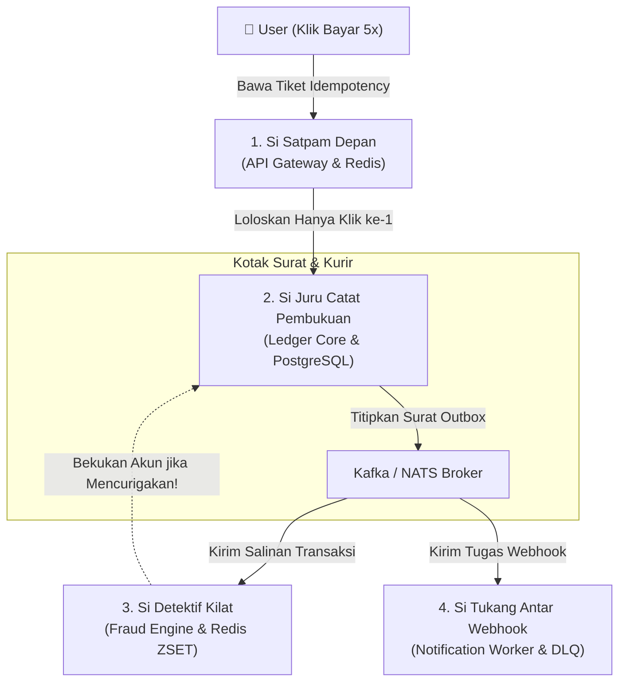

# 💡 Konsep & Analogi Inti Sistem: Financial Ledger & Fraud Engine

> **Panduan Pemahaman Santai & Analogi Dunia Nyata**  
> Dokumen ini menjelaskan cara kerja sistem tanpa jargon rumit. Untuk spesifikasi teknis dan blueprint implementasi, baca [README.md](./README.md).

---

## 😱 3 Mimpi Buruk dalam Sistem Keuangan Digital

Bayangkan kamu sedang membangun sistem dompet digital (seperti GoPay, OVO, atau Stripe). Ada 3 skenario horor yang paling sering terjadi jika arsitekturnya salah:

```
[ User Klik 5x ]  ───────►  1. Saldo Kepotong Dobel (Double Charge)
[ Internet Putus ] ───────►  2. Uang Lenyap / Selisih Gaib (Inconsistent State)
[ Hacker Brutal ] ───────►  3. Rekening Dikuras Cepat (Fraud & Velocity Attack)
```

1. **Saldo Kepotong Dobel (*Double Charge*):**  
   User menekan tombol *"Bayar"* saat koneksi internet lambat. Karena layarnya loading, dia panik dan menekan tombolnya 5 kali lagi. Jika sistem tidak pintar, saldo user terpotong 5 kali lipat.
2. **Uang Lenyap atau Bertambah Gaib (*Data Inconsistency*):**  
   Uang Rp 100.000 sudah keluar dari rekening A, tapi saat mau masuk ke rekening B server tiba-tiba mati lampu. Akibatnya: Uang di A hilang, tapi di B tidak pernah sampai.
3. **Rekening Dikuras Cepat (*Fraud/Velocity Attack*):**  
   Penipu membobol akun dan melakukan 10 transaksi transfer kecil-kecil dalam tempo 15 detik sebelum pemilik akun sempat memblokirnya.

---

## 👥 4 "Petugas" Utama (The Microservices Team)

Untuk menyelesaikan 3 mimpi buruk di atas, kita membagi sistem menjadi **4 petugas independen** yang bekerja di ruangannya masing-masing:



---

### 1. 👮 Si "Satpam Depan" (API Gateway + Redis Idempotency)
* **Peran:** Menjaga pintu masuk agar user tidak bayar dobel.
* **Cara Kerja:**
  Setiap kali tombol "Bayar" ditekan, aplikasi HP menempelkan **nomor tiket unik** (`Idempotency-Key`, contoh: `uuid-1234-abcd`).
  * **Klik ke-1:** Satpam mengecek buku tamu di memori kilat (Redis). *"Tiket `uuid-1234-abcd` belum pernah ada. Silakan masuk!"*. Satpam langsung mencatat tiket itu dengan status `SEDANG DIPROSES`.
  * **Klik ke-2 sampai ke-5:** Satpam melihat tiketnya: *"Eh, tiket ini kan sedang diproses! Tunggu sebentar!"* (Tolak dengan HTTP 409 Conflict).
  * Begitu proses selesai, jawaban disimpan di Redis. Kalau user reload halaman, Satpam langsung menyerahkan tanda terima lama tanpa mengulang pemotongan uang.

---

### 2. 📖 Si "Juru Catat Pembukuan" (Core Ledger + PostgreSQL)
* **Peran:** Menjamin uang tidak pernah lenyap atau bertambah dari udara kosong.
* **Cara Kerja:**
  Juru catat tidak pernah menggunakan perintah sembarangan seperti `saldo = saldo - 50.000`. Dia memakai aturan **Double-Entry Bookkeeping** (pembukuan berpasangan) yang sudah dipakai perbankan selama ratusan tahun:
  
  | No | Akun | Posisi | Nominal |
  | :--- | :--- | :--- | :--- |
  | 1 | Rekening Pengirim (User A) | **Kredit (Keluar)** | Rp 50.000 |
  | 2 | Rekening Penerima (User B) | **Debit (Masuk)** | Rp 50.000 |
  | **Total** | | **Selisih Wajib** | **Rp 0 (Balance)** |

  * **Hukum Mutlak:** Jika di tengah jalan server meledak atau listrik mati sebelum langkah ke-2 selesai dicatat, PostgreSQL akan membatalkan semuanya (*Rollback* atomik). Uang tidak akan pernah keluar setengah jalan.

---

### 3. 🕵️‍♂️ Si "Detektif Kilat" (Real-Time Fraud Engine + Redis)
* **Peran:** Menangkap pencuri data dalam hitungan milidetik sebelum uang ditarik.
* **Cara Kerja:**
  Detektif ini tidak membaca database disk yang lambat. Dia memegang **stopwatch di memori (Redis Sorted Sets)**.
  * Setiap ada transaksi, dia mencatat waktu detiknya.
  * Dia menghitung: *"Berapa kali user ini transfer dalam 60 detik terakhir?"*
  * Jika angkanya tembus > 5 kali atau ada lonjakan transaksi dari lokasi tak wajar, dalam waktu **kurang dari 5 milidetik**, detektif ini mengirim sinyal darurat: **BEKUKAN REKENING INI SEKARANG!**

---

### 4. 📬 Si "Tukang Antar Webhook" (Notification Worker + DLQ)
* **Peran:** Mengabari sistem luar (WhatsApp, Email, Server Toko Merchant).
* **Cara Kerja:**
  Juru Catat tidak boleh menunggu pesan WhatsApp selesai terkirim baru membalas ke user (karena server WhatsApp bisa saja sedang lambat 10 detik).
  * Juru Catat cukup melempar surat ke kotak pos (**Kafka**).
  * Si Tukang Antar mengambil surat di background.
  * Kalau server merchant tujuan sedang *down*, dia tidak panik. Dia coba lagi:
    * Percobaan 1: tunggu 1 detik
    * Percobaan 2: tunggu 2 detik
    * Percobaan 3: tunggu 4 detik
  * Kalau tetap gagal setelah 3x, surat disimpan di **Kotak Sampah Khusus (*Dead Letter Queue / DLQ*)** agar bisa dicek manual oleh teknisi, tanpa memacetkan transaksi user lain.

---

## 📹 CCTV Pemantau (Distributed Tracing & Metrics)

Karena keempat petugas tadi berada di ruangan yang berbeda dan berbicara lewat kabel jaringan, kita memasang kamera pengawas pintar (**OpenTelemetry & Jaeger**).

Saat user menekan *"Bayar"*, sistem memberikan **1 nomor pelacak (Trace ID)** yang ditempelkan di amplop surat:
```text
TraceID: 7a8b-9c0d-1e2f
├── [Gateway]        Terima request HTTP          (Durasi: 2ms)
│   ├── [Redis]      Cek Idempotency Key          (Durasi: 1ms)
│   └── [gRPC]       Panggil Core Ledger          (Durasi: 15ms)
│       ├── [DB]     Kunci baris & mutasi ACID    (Durasi: 8ms)
│       └── [Outbox] Tulis event ke database      (Durasi: 2ms)
├── [Kafka]          Event dialirkan ke broker    (Durasi: 3ms)
│   ├── [Fraud]      Analisis kecepatan transfer  (Durasi: 4ms)
│   └── [Worker]     Kirim webhook ke merchant    (Durasi: 45ms)
```

Dengan CCTV ini, jika ada keluhan *"Kok transfer saya lambat?"*, kita tinggal membuka dashboard **Jaeger/Grafana** dan langsung tahu detik mana yang menyebabkan antrean.

---

## 🎯 Ringkasan Pemetaan: Bahasa Sederhana vs Istilah Teknis

| Bahasa Sederhana | Istilah Teknis Asli | Teknologi yang Digunakan |
| :--- | :--- | :--- |
| **Pintu Masuk & Tiket Anti-Dobel** | API Gateway & Distributed Idempotency | Go HTTP, Redis Atomic `SET NX EX` |
| **Juru Catat Pembukuan Nol-Selisih** | Core Ledger & Double-Entry Bookkeeping | Go, PostgreSQL ACID, `SELECT FOR UPDATE` |
| **Surat Dititipkan di Database Dulu**| Transactional Outbox Pattern | PostgreSQL Table + Background Relay Worker |
| **Kotak Surat Terdistribusi** | Message Broker & Event Log | Apache Kafka / NATS JetStream |
| **Detektif Stopwatch Kilat** | Real-Time Sliding-Window Stream Engine | Redis Sorted Sets (`ZADD`, `ZCARD`) |
| **Kurir Anti-Macet & Kotak Gagal** | Async Consumer & Dead Letter Queue (DLQ) | Go Worker Pool, Kafka Consumer Group |
| **Kamera CCTV Lintas Ruangan** | Distributed Tracing & Metrics | OpenTelemetry, Jaeger, Prometheus, Grafana |

---
*👉 Siap menyelami kode dan langkah teknisnya? Buka [README.md](./README.md) untuk roadmap pengerjaan 7 fase.*
