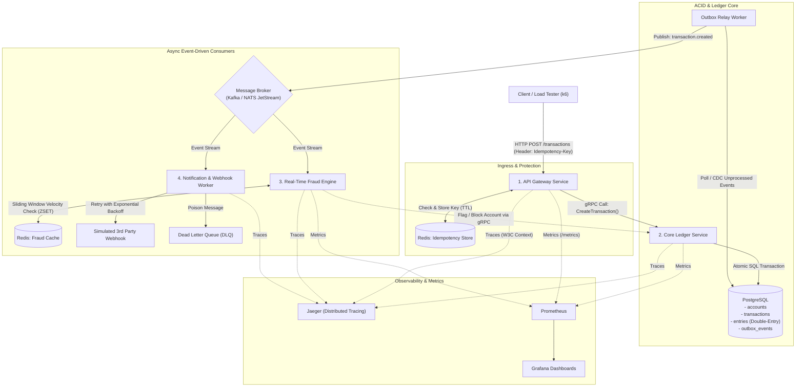

# 🏛️ Distributed Financial Ledger & Real-Time Fraud Engine

> **Production-Grade Event-Driven Microservices in Go**  
> Sebuah sistem terdistribusi modern yang mengimplementasikan *Double-Entry Bookkeeping*, *Transactional Outbox Pattern*, *Distributed Idempotency*, dan *Sliding-Window Fraud Detection*.

> [!TIP]
> **Mencari penjelasan konsep dengan bahasa santai & analogi dunia nyata?**  
> Baca **[CONCEPT.md](./CONCEPT.md)** untuk analogi tim 4 petugas (Satpam, Juru Catat, Detektif, dan Kurir). Dokumen README ini fokus pada arsitektur teknis dan roadmap implementasi.

---

## 🎯 Gambaran Sistem & Arsitektur

Sistem ini memecahkan masalah mission-critical pada fintech: **menjamin saldo tidak pernah korup/selisih 1 rupiah pun, transaksi kebal terhadap double-spending akibat network retry, serta mendeteksi transaksi mencurigakan dalam hitungan milidetik secara real-time.**



---

## 🛠️ Tech Stack & Distributed Tools

| Layer | Komponen / Tools | Alasan Pemilihan & Karakteristik |
| :--- | :--- | :--- |
| **Language** | **Go (Golang 1.23+)** | Bahasa standar infrastruktur cloud & distributed systems (Docker, K8s, Etcd). |
| **Inter-Service RPC** | **gRPC & Protocol Buffers** | Komunikasi sinkron antar-servis berkemampuan tinggi dengan schema contract kaku. |
| **Primary Database** | **PostgreSQL** | Strict ACID compliance, Row-Level Locking (`SELECT FOR UPDATE`), dan transactional outbox. |
| **In-Memory & Cache** | **Redis** | Operasi atomik untuk *Idempotency locking* dan *Sliding-Window Sorted Sets* (< 2ms). |
| **Event Broker** | **Kafka / NATS JetStream** | Menjamin log event berurutan (*partitioned event log*), *durable consumer groups*, dan *replayability*. |
| **Distributed Tracing** | **OpenTelemetry + Jaeger** | Melacak siklus hidup satu request dari Gateway $\to$ gRPC $\to$ DB $\to$ Kafka $\to$ Consumer. |
| **Metrics & Alerting** | **Prometheus + Grafana** | Memantau P95/P99 latency, RPS, Error Rate, dan Consumer Lag. |
| **Container & Cloud** | **Multi-Stage Docker + K8s** | Image mini (~15MB Distroless/Alpine), K8s Deployment, Ingress, ConfigMap, dan HPA Auto-Scaling. |
| **Stress & Chaos Test**| **k6 + Chaos Injection** | Menguji ketahanan konkurensi (5.000 RPS) dan pembuktian zero-loss data saat node mati mendadak. |

---

## 📂 Struktur Repositori (Go Monorepo Standard)

```text
.
├── api/
│   └── proto/                     # Protocol Buffer definitions (.proto)
│       ├── ledger/v1/
│       └── fraud/v1/
├── build/                         # Dockerfiles untuk setiap service
│   ├── Dockerfile.gateway
│   ├── Dockerfile.ledger
│   ├── Dockerfile.fraud
│   └── Dockerfile.notification
├── deployments/                   # Orkestrasi lokal, K8s & monitoring
│   ├── docker-compose.yml         # Postgres, Redis, Kafka, Jaeger, Prometheus, Grafana
│   ├── prometheus.yml
│   ├── grafana/
│   │   └── provisioning/
│   └── k8s/                       # Manifest Kubernetes (Deployments, Services, HPA, Ingress)
│       ├── kustomization.yaml
│       ├── gateway/
│       ├── ledger/
│       ├── fraud/
│       ├── notification/
│       └── shared/                # ConfigMaps, Secrets, Ingress, HPA
├── services/                      # 4 Microservices Independen
│   ├── gateway/                   # API Gateway & Idempotency
│   │   ├── cmd/main.go
│   │   └── internal/
│   ├── ledger/                    # Core Accounting & Outbox Publisher
│   │   ├── cmd/main.go
│   │   └── internal/
│   ├── fraud/                     # Real-time Stream Analytics
│   │   ├── cmd/main.go
│   │   └── internal/
│   └── notification/              # Async Consumer & DLQ
│       ├── cmd/
│       │   ├── main.go
│       │   └── redrive/main.go    # SRE DLQ Replay CLI Tool
│       └── internal/
├── pkg/                           # Shared internal libraries (anti-bloat)
│   ├── telemetry/                 # OpenTelemetry Tracer & Meter setup
│   ├── logger/                    # Structured JSON Logger (slog)
│   └── errs/                      # Domain errors & gRPC error mapping
├── scripts/
│   ├── migrations/                # PostgreSQL schema migrations
│   └── loadtest/                  # k6 load testing scripts
├── go.work                        # Go Multi-Module Workspace
├── CONCEPT.md                     # Panduan konsep & analogi sederhana
└── README.md                      # Blueprint teknis & roadmap implementasi
```

---

## 🗺️ Urutan Pengerjaan Step-by-Step (Execution Roadmap)

Proyek ini dirancang secara modular dalam **8 Fase Terstruktur**. Setiap fase menyelesaikan satu masalah komputasi terdistribusi spesifik:

```mermaid
flowchart LR
    P0["Fase 0:\nInfra & Scaffolding"] --> P1["Fase 1:\nCore Ledger (ACID)"]
    P1 --> P2["Fase 2:\nGateway & Idempotency"]
    P2 --> P3["Fase 3:\nOutbox & Broker"]
    P3 --> P4["Fase 4:\nReal-Time Fraud Engine"]
    P4 --> P5["Fase 5:\nResilient Worker (DLQ)"]
    P5 --> P6["Fase 6:\nObservability (OTel)"]
    P6 --> P7["Fase 7:\nBenchmarking & Chaos"]
    P7 --> P8["Fase 8:\nKubernetes (K8s) Deploy"]
```



---

### 🔹 Fase 0: Infrastructure & Workspace Scaffolding
*Tujuan: Memastikan seluruh ekosistem pendukung lokal menyala dalam 1 perintah.*
1. Buat `deployments/docker-compose.yml` yang berisi:
   * PostgreSQL 16
   * Redis 7
   * Kafka (KRaft mode) atau NATS JetStream
   * Jaeger All-in-One
   * Prometheus & Grafana
2. Siapkan `go.work` untuk mendukung multi-module Go monorepo tanpa dependency conflict.
3. Buat modul dasar untuk structured logging (`pkg/logger`) menggunakan Go 1.21+ `log/slog`.

---

### 🔹 Fase 1: Core Ledger Service (ACID & Double-Entry Accounting)
*Tujuan: Membangun fondasi integritas data finansial yang kebal terhadap pembukuan janggal.*
1. **Skema Database Relasional (PostgreSQL):**
   * Tabel `accounts`: Menyimpan saldo agregat, currency, dan status (`ACTIVE`, `FROZEN`).
   * Tabel `transactions`: Header transaksi (ID, deskripsi, reference, status).
   * Tabel `entries`: Mutasi debit dan kredit. **Hukum Invarian:** Dalam satu transaksi, `SUM(debit) - SUM(credit) = 0`.
2. **Atomic Ledger Engine:**
   * Eksekusi transaksi mutasi menggunakan `BEGIN ... COMMIT` dengan `SELECT FOR UPDATE` pada baris akun terkait untuk mencegah race condition.
3. **Protobuf & gRPC Interface:**
   * Definisikan kontrak proto `CreateTransaction` dan `GetAccountBalance`.
   * Compile `.proto` ke Go code menggunakan `protoc`.

---

### 🔹 Fase 2: API Gateway & Distributed Idempotency Engine
*Tujuan: Mencegah eksekusi ganda saat network timeout atau client retry.*
1. **HTTP Server & Routing:**
   * Menerima request eksternal via REST HTTP JSON.
2. **Idempotency Layer dengan Redis:**
   * Baca header `Idempotency-Key` (UUIDv4) dari client.
   * Gunakan Redis atomic `SET key val NX EX 120` (Lock & TTL).
   * Jika key sudah ada dan status masih `PROCESSING`: Tolak dengan HTTP 409 Conflict.
   * Jika key sudah ada dan status `COMPLETED`: Langsung return respon yang di-cache di Redis tanpa memanggil Ledger Service lagi.
3. **gRPC Client:**
   * Teruskan request yang valid ke Core Ledger Service via koneksi gRPC internal.

---

### 🔹 Fase 3: The Dual-Write Solution (Transactional Outbox Pattern)
*Tujuan: Mengirim event ke Kafka tanpa resiko inkonsistensi saat salah satu sistem mati.*
1. **Outbox Table di PostgreSQL:**
   * Buat tabel `outbox_events` (id, aggregate_type, payload JSON, status `PENDING`/`PROCESSED`, created_at).
   * Masukkan record event ke tabel outbox **di dalam database transaction yang sama** dengan mutasi ledger.
2. **Background Outbox Relay Worker:**
   * Worker di Go membaca record outbox berkala (`FOR UPDATE SKIP LOCKED`), mempublikasikan pesan ke topik Kafka `transaction.created`, lalu menandai record sebagai `PROCESSED`.

---

### 🔹 Fase 4: Real-Time Fraud & Anomaly Engine
*Tujuan: Mendeteksi indikasi fraud dalam stream data dengan latensi < 5ms tanpa mengorbankan pengalaman nasabah sah.*
1. **Kafka Consumer Group:**
   * Fraud Engine mendengarkan event stream `transaction.created`.
2. **Multi-Tier Sliding-Window Velocity Check di Redis (ZSET):**
   * Gunakan Redis **Sorted Sets (ZSET)** (`ZADD`, `ZREMRANGEBYSCORE`, `ZCARD`, `ZCOUNT`, `ZRANGE`).
   * Eksekusi *atomic pipeline* di memori RAM dengan latensi sub-2ms.
   * **Anti-Bot Burst Window (10s):** Deteksi serangan skrip bot jika terjadi > 3 transaksi dalam 10 detik (melanggar batas biologis manusia).
   * **Cumulative Volume Window (60s):** Deteksi pencucian uang/pengurasan bertahap (*structuring/smurfing*) jika total akumulasi > Rp 100 Juta dalam 1 menit.
   * **Sustained Velocity Window (60s):** Toleransi wajar hingga 10 transaksi per menit untuk nasabah retail dan merchant.
3. **Advanced Action Matrix & Risk Decisioning (FAANG/Banking Standard):**
   * Alih-alih pembekuan biner yang kaku, sistem menerapkan respon adaptif bertingkat:
     * `ACTION_ALLOW` (Risk Score: 10): Transaksi bersih, lolos seketika tanpa hambatan.
     * `ACTION_CHALLENGE` (Risk Score: 50): Transaksi bernominal besar/jumbo (misal: beli mobil/properti $\ge$ Rp 50 Juta). **Akun TIDAK dibekukan**, melainkan sistem menerbitkan event `fraud.challenge_required` ke Kafka untuk meminta verifikasi biometrik wajah / OTP 2FA.
     * `ACTION_HOLD` (Risk Score: 65): Transaksi pecah-pecah bertahap yang melewati batas volume kumulatif. **Akun TIDAK dibekukan**, melainkan transaksi ditahan sementara (10 menit) dan diterbitkan event `fraud.review_hold` ke Kafka untuk konfirmasi nasabah.
     * `ACTION_FREEZE` (Risk Score: 85 - 95): Serangan bot kilat atau sustained velocity ekstrim. Sistem langsung menembak panggilan gRPC `FreezeAccount` ke Core Ledger untuk mengunci akun seketika dan menerbitkan event audit `fraud.flagged`.
4. **12-Factor Dynamic Configuration:**
   * Seluruh parameter ambang batas (`FRAUD_WINDOW_DURATION_SEC`, `FRAUD_MAX_IN_WINDOW`, `FRAUD_BURST_WINDOW_SEC`, `FRAUD_MAX_BURST`, `FRAUD_CUMULATIVE_AMOUNT_THRESHOLD`, `FRAUD_HIGH_AMOUNT_THRESHOLD`) dapat disetel secara dinamis via Environment Variables tanpa kompilasi ulang.

---

### 🔹 Fase 5: Resilient Notification Worker & Dead Letter Queue (DLQ)
*Tujuan: Menangani kegagalan integrasi pihak ketiga secara elegan tanpa kehilangan data dan tanpa memblokir antrean event.*
1. **Concurrent Worker Pool (`services/notification`):**
   * Worker memproses event stream `transaction.created` menggunakan armada paralel (*Goroutine Semaphore Worker Pool*, default: 5 worker concurrency).
   * Dilengkapi *Graceful Drain* (`sync.WaitGroup`) sehingga saat proses shutdown, webhook yang sedang in-flight diselesaikan tuntas sebelum exit.
2. **Error Classification & AWS Equal Jitter Exponential Backoff:**
   * Klasifikasi error pintar: membedakan antara *Transient Failure* (`RetryableError`: HTTP 5xx, timeout, network error) vs *Permanent Client Failure* (`NonRetryableError`: HTTP 4xx Bad Request).
   * Menerapkan algoritma **AWS Equal Jitter**:
     $$\text{sleep} = \frac{\text{backoff}}{2} + \text{rand}\left(0, \frac{\text{backoff}}{2}\right)$$
     Mereduksi risiko *Thundering Herd Problem* / *Self-DDoS* saat ribuan webhook gagal bersamaan.
   * Pada kegagalan *non-retryable*, sistem langsung menghentikan percobaan agar tidak membuang resource secara sia-sia.
3. **Dead Letter Queue (DLQ):**
   * Jika seluruh kuota retry habis (default: 3x retry = 4 percobaan total) atau terjadi error fatal, pesan dialihkan ke topik Kafka `transaction.dlq`.
   * Struktur pesan DLQ membungkus: `original_topic`, `original_key`, `payload`, `error_reason`, `retry_count`, dan `failed_at`.
   * Offset partisi Kafka utama tetap di-*commit* sehingga *poison message* tidak pernah menimbulkan *Head-of-Line Blocking* bagi transaksi nasabah lainnya.
4. **DLQ Re-drive Engine & Standalone CLI Tool:**
   * Menyediakan modul `DLQRedriver` ([`services/notification/internal/consumer/redrive.go`](./services/notification/internal/consumer/redrive.go)) dan CLI tool mandiri ([`services/notification/cmd/redrive/main.go`](./services/notification/cmd/redrive/main.go)).
   * Memungkinkan tim SRE memutar ulang (*replay*) pesan yang tertahan di `transaction.dlq` kembali ke topik aktif `transaction.created` setelah server pihak ketiga dipastikan normal kembali:
     ```bash
     go run ./services/notification/cmd/redrive -dlq-topic=transaction.dlq -max=500
     ```

---

### 🔹 Fase 6: Production-Grade Observability (OpenTelemetry, Prometheus & Grafana)
*Tujuan: Membuka visibilitas menyeluruh terhadap seluruh alur data yang melintasi batas jaringan microservices.*
1. **End-to-End Distributed Tracing (OpenTelemetry + Jaeger):**
   * Paket utilitas sentral di `pkg/telemetry/`.
   * Standardisasi W3C Trace Context (`traceparent` header).
   * **Full Trace Lifecycle Across Boundaries:** Ekstrak W3C pada HTTP Gateway $\to$ Injeksi ke internal gRPC metadata $\to$ Ekstrak di Core Ledger $\to$ **Persistensi W3C TraceContext ke tabel PostgreSQL `outbox_events` (JSON payload)** $\to$ Ekstrak di Outbox Relay Worker $\to$ Injeksi ke header Kafka partition $\to$ Ekstrak di Fraud Engine & Notification Worker.
   * Satu request transfer dari client menghasilkan **satu Trace ID tunggal** yang memvisualisasikan seluruh perjalanan transaksi di Jaeger UI (`:16686`) tanpa terputus di level database outbox.
   * *Graceful Fallback:* Jika OTLP Jaeger sedang offline, tracer otomatis beralih ke *Noop Tracer* tanpa menyebabkan *panic* atau *crash*.
2. **Prometheus Metrics Instrumentation:**
   * Eksposur metrik produksi di setiap service:
     * API Gateway (`:8000/metrics`): `http_requests_total`, `http_request_duration_seconds`.
     * Core Ledger (`:9111/metrics`): `ledger_transactions_total` (labeled by status: `POSTED`).
     * Fraud Engine (`:9102/metrics`): `fraud_evaluations_total` (labeled by action: `ALLOW`, `CHALLENGE`, `HOLD`, `FREEZE`).
     * Notification Worker (`:9103/metrics`): `notifications_dispatched_total`, `notification_retries_total`, `notification_dlq_total`.
   * `deployments/prometheus.yml` sudah dikonfigurasi untuk men-scrape keempat endpoint service secara periodik.

---

### 🔹 Fase 7: Battle-Testing, Chaos Injection & Portfolio Proof
*Tujuan: Membuktikan kekuatan sistem secara komputasi dan menjadikannya showcase portfolio.*
1. **k6 Load Testing Script:**
   * Tembak Gateway dengan 2.000 – 5.000 RPS simultan.
   * Uji kasus ekstrim: 1.000 request bersamaan menggunakan `Idempotency-Key` yang sama (pastikan hanya tepat 1 yang dieksekusi).
2. **Chaos Engineering Experiment:**
   * Matikan container Kafka mendadak saat transaksi berlangsung. Verifikasi bahwa PostgreSQL tetap konsisten dan worker melanjutkan antrean saat Kafka hidup kembali.
   * Matikan database PostgreSQL; pastikan API Gateway merespon dengan graceful error handling tanpa crash/panic.
3. **Dokumentasi Hasil di README:**
   * Lampirkan screenshot Jaeger Trace, dashboard Grafana, dan hasil report k6 sebagai bukti validitas portfolio.

---

### 🔹 Fase 8: Cloud-Native Kubernetes (K8s) Orchestration & Auto-Scaling
*Tujuan: Membawa microservices Go ke level produksi enterprise menggunakan kluster Kubernetes.*
1. **Multi-Stage Distroless / Alpine Dockerfiles:**
   * Buat `build/Dockerfile.*` dengan teknik multi-stage compilation Go untuk memangkas ukuran container dari ~1GB menjadi hanya **~15MB** (keamanan tinggi, zero CVE shell vulnerability).
2. **Kubernetes Core Manifests (`deployments/k8s/`):**
   * **Deployments:** Manifest pod untuk `gateway`, `ledger`, `fraud`, dan `notification`.
   * **Services & CoreDNS:** K8s `ClusterIP` untuk routing internal gRPC (`ledger-service.default.svc.cluster.local:9101`).
   * **ConfigMaps & Secrets:** Memisahkan credential database, redis, dan broker dari kode sumber.
   * **Ingress Controller:** Mengarahkan traffic HTTP dari domain luar langsung ke pod Gateway.
3. **Resilience & Health Probes:**
   * Pasang `livenessProbe` dan `readinessProbe` di setiap manifest untuk kemampuan *self-healing* otomatis jika ada Pod yang macet.
4. **Horizontal Pod Autoscaler (HPA):**
   * Konfigurasi K8s HPA agar Gateway dan Fraud Engine otomatis me-scale jumlah Pod (misal: dari 2 Pod menjadi 10 Pod) saat CPU load atau RPS melonjak tinggi saat load test.
5. **One-Command K8s Deploy:**
   * Manajemen deployment modular via Kustomize:
     ```bash
     kubectl apply -k deployments/k8s/
     ```

---

## ⚡ Nilai Jual Utama di CV & Interview Kerja

Setelah menyelesaikan proyek ini, kamu dapat mencantumkan poin-poin berikut di resume/LinkedIn:
* *"Merancang sistem distributed core banking ledger di Go berbasis Double-Entry Accounting dengan zero-balance error margin."*
* *"Mengeliminasi resiko inkonsistensi Dual-Write antara RDBMS dan Message Broker menggunakan Transactional Outbox Pattern."*
* *"Menerapkan distributed idempotency engine berbasis Redis atomic locks, sukses mereduksi 100% duplicate charge akibat network retries."*
* *"Membangun real-time fraud detector berlatensi < 5ms memanfaatkan Redis Sliding Window Sorted Sets pada event stream Kafka."*
* *"Mengimplementasikan end-to-end distributed tracing menggunakan OpenTelemetry lintas HTTP, gRPC, dan Message Broker."*
* *"Mengemas arsitektur microservices ke dalam Kubernetes (K8s) manifests dengan konfigurasi HPA auto-scaling, Ingress, dan zero-downtime rolling updates."*
